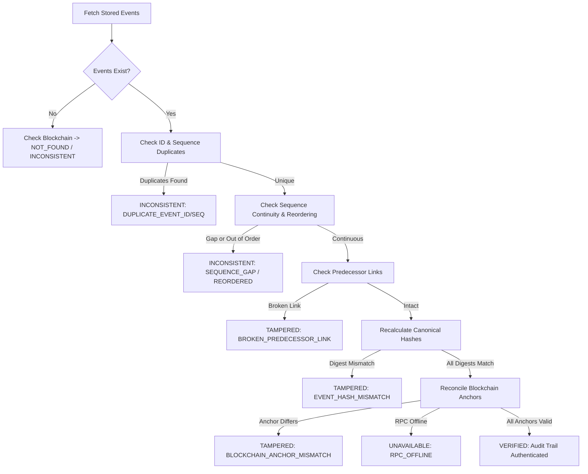

# ChainVault — Phase 2: Tamper-Evident Custody Audit Trail & Independent Verification
## Architectural Specification, Integrity Verification Engine & Reconciliation Model

**Document Version:** 1.0.0  
**Phase:** Phase 2 Implementation  
**Status:** Implemented & Verified (122/122 Automated Tests Passing)  
**Applicable Checkpoint:** `569d1d6` (Master)  

---

## 1. Executive Summary & Goals

ChainVault Phase 2 introduces a tamper-evident, versioned, hash-linked chain-of-custody audit trail and an independent cryptographic verification engine. 

### Critical Security Rule:
> **A hash-linked event sequence alone does not guarantee tamper resistance.**  
> An attacker who compromises the database and possesses write permissions could theoretically modify historical records, recompute every hash from the modification point onward, and produce a new internally consistent sequence.  
> Therefore, ChainVault combines:
> 1. **Off-Chain Structural Integrity:** Monotonically ordered, canonically hashed, predecessor-linked events.
> 2. **Independent Blockchain Anchors:** Cryptographic commitments anchored to the Ethereum ledger (`EvidenceRegistry.sol`).

---

## 2. Custody Event Data Model & Schema Versioning

All chain-of-custody actions produce structured, immutable events adhering to **Schema Version 1**:

```json
{
  "schema_version": 1,
  "event_id": "EVT-EV-DEMO-001-0001-A4F79C",
  "log_id": "EVT-EV-DEMO-001-0001-A4F79C",
  "evidence_id": "EV-DEMO-001",
  "case_id": "CV-2026-001",
  "actor_id": "investigator1",
  "action": "EVIDENCE_INGESTION",
  "timestamp": "2026-10-16T08:15:20.123456Z",
  "sequence_number": 1,
  "previous_event_hash": "GENESIS",
  "event_hash": "a4f89d318e7c10b4...",
  "anchor_reference": "0x82edf0b41ef4957c48d2649fbe28fa8e7944ea3ae02c1981c4d103ead94d2a4b",
  "blockchain_tx": "0x82edf0b41ef4957c48d2649fbe28fa8e7944ea3ae02c1981c4d103ead94d2a4b",
  "details": {
    "file_hash": "e3b0c44298fc1c149afbf4c8996fb92427ae41e4649b934ca495991b7852b855",
    "filename": "specimen_001.bin",
    "previous_custodian": "None",
    "new_custodian": "investigator1",
    "reason": "Initial digital evidence ingestion"
  },
  "previous_custodian": "None",
  "new_custodian": "investigator1",
  "reason": "Initial digital evidence ingestion"
}
```

### Field Definitions:
- `schema_version` (Integer): Currently `1`. Governs the canonicalization format.
- `event_id` (String): Globally unique event identifier (`EVT-{evidence_id}-{sequence_number:04d}-{uuid4}`).
- `evidence_id` (String): Immutable reference to the associated evidence item.
- `case_id` (String): Associated case reference.
- `actor_id` (String): Authenticated identity derived strictly from server-side JWT session (never client-supplied).
- `action` (String): Defined event taxonomy:
  - `EVIDENCE_INGESTION`: Genesis event upon evidence file ingestion.
  - `BLOCKCHAIN_REGISTRATION`: Event recorded when anchored on-chain.
  - `CUSTODY_TRANSFER`: Custody handover between authenticated actors.
  - `INTEGRITY_VERIFICATION`: Authorized verification audit milestone.
- `timestamp` (String): Server-generated UTC ISO-8601 string (`YYYY-MM-DDTHH:MM:SS.ffffffZ`).
- `sequence_number` (Integer): Monotonically increasing sequence strictly starting at `1`.
- `previous_event_hash` (String): SHA-256 hash of preceding event. For sequence 1 (Genesis), exactly `"GENESIS"`.
- `event_hash` (String): SHA-256 hex digest of canonicalized event bytes.
- `anchor_reference` (String/Optional): Ethereum transaction hash anchoring the event to the blockchain.
- `details` (Dict): Action-specific key-value metadata (sorted deterministically during hashing).

---

## 3. Deterministic Canonical Hash Calculation

To ensure cross-platform determinism and prevent replay or collision attacks:

1. **Included Fields:**
   `schema_version`, `event_id`, `evidence_id`, `case_id`, `actor_id`, `action`, `timestamp`, `sequence_number`, `previous_event_hash`, `details`.
2. **Explicitly Excluded Fields:**
   - `event_hash`: Cannot compute hash over itself.
   - `anchor_reference` / `blockchain_tx`: Populated asynchronously after mining.
   - Aliases (`log_id`, `previous_custodian`, `new_custodian`, `reason`): Present for backward-compatibility only.
3. **Timestamp Normalization:**
   Normalized to UTC ISO-8601 with microsecond resolution ending in `Z` (`%Y-%m-%dT%H:%M:%S.%fZ`).
4. **Serialization:**
   UTF-8 JSON encoding with keys sorted alphabetically (`sort_keys=True`) and compact delimiters (`separators=(',', ':')`).
5. **Cryptographic Algorithm:**
   SHA-256 (`hashlib.sha256(canonical_bytes).hexdigest()`).

---

## 4. Concurrency Control & Event Ordering

- **Per-Evidence Locks:** `get_evidence_lock(evidence_id)` maintains an in-memory asynchronous lock (`asyncio.Lock`) for each evidence item during event creation.
- **Strict Monotonicity:** Before assigning `sequence_number = N`, the service verifies sequence `N - 1` exists.
- **Collision Rejection:** Duplicate event IDs or conflicting sequence numbers are rejected without overwriting or branching.
- **MongoDB Constraints:** Persistent unique indexes enforce database-level consistency:
  - `{"evidence_id": 1, "sequence_number": 1}` (Unique)
  - `{"event_id": 1}` (Unique)

---

## 5. Audit Trail Verification Engine

The verification engine (`verify_custody_audit_trail`) executes **10 sequential validations**:



### Verification States:
1. `VERIFIED`: Complete sequence, canonical hashes, predecessor links, and required blockchain anchors agree.
2. `TAMPERED`: Confirmed hash mismatch, modified event content, or broken predecessor link.
3. `INCONSISTENT`: Structural conflict, sequence gap, duplicate identifier, or unanchored history.
4. `NOT_FOUND`: Evidence or custody history does not exist in database or blockchain registry.
5. `UNAVAILABLE`: Verification cannot complete because required blockchain node is unreachable (fails closed).

---

## 6. Smart Contract Compatibility & Limitation Analysis

### Current Contract Deployment:
- **Contract:** `EvidenceRegistry.sol`
- **Address:** `0x5FbDB2315678afecb367f032d93F642f64180aa3` (Local Hardhat Node, Chain ID `31337`)

### Contract Capabilities in Phase 2:
- `registerEvidence(evidenceId, caseId, fileHash)`: Anchors Genesis event (file hash, case ID, registration timestamp, initial custodian).
- `transferCustody(evidenceId, newCustodian, reason)`: Broadcasts on-chain custody handover, emits `CustodyTransferred`, and stores transaction receipt.
- `getEvidence(evidenceId)`: Returns current on-chain custodian and authentic file hash.
- `getCustodyHistoryCount(evidenceId)`: Returns total transfer count.

### Exact Contract Limitation:
1. `EvidenceRegistry.sol` stores custody history in `mapping(string => CustodyLog[]) private custodyHistory`.
2. There is **no public view getter** (e.g. `getCustodyLog(evidenceId, index)`) to retrieve the stored log contents directly via `eth_call`.
3. The contract lacks a dedicated `anchorAuditCheckpoint(string evidenceId, uint256 sequenceNumber, bytes32 checkpointHash)` method for directly committing intermediate audit event hashes into contract storage.

### Proposed Backward-Compatible Contract Extension (`EvidenceRegistryV2`):
```solidity
// SPDX-License-Identifier: MIT
pragma solidity ^0.8.19;

import "./EvidenceRegistry.sol";

contract EvidenceRegistryV2 is EvidenceRegistry {
    // Mapping: evidenceId => sequenceNumber => checkpointHash
    mapping(string => mapping(uint256 => bytes32)) private auditCheckpoints;
    mapping(string => uint256) private latestAuditSequence;

    event AuditCheckpointAnchored(
        string indexed evidenceId,
        uint256 indexed sequenceNumber,
        bytes32 checkpointHash,
        uint256 timestamp
    );

    function anchorAuditCheckpoint(
        string memory evidenceId,
        uint256 sequenceNumber,
        bytes32 checkpointHash
    ) external onlyAdmin evidenceExists(evidenceId) {
        require(sequenceNumber == latestAuditSequence[evidenceId] + 1, "Non-sequential checkpoint");
        auditCheckpoints[evidenceId][sequenceNumber] = checkpointHash;
        latestAuditSequence[evidenceId] = sequenceNumber;
        emit AuditCheckpointAnchored(evidenceId, sequenceNumber, checkpointHash, block.timestamp);
    }

    function getAuditCheckpoint(
        string memory evidenceId,
        uint256 sequenceNumber
    ) external view returns (bytes32) {
        return auditCheckpoints[evidenceId][sequenceNumber];
    }
}
```
*Note: In accordance with the Contract Compatibility Rule, this contract extension is documented and proposed, awaiting explicit approval before deployment.*

---

## 7. Verification API Endpoints

| Method | Endpoint | Allowed Roles | Description |
|---|---|---|---|
| `GET` | `/api/audit/logs/{evidence_id}` | All Authenticated | Retrieve complete versioned custody event trail |
| `GET` | `/api/audit/verify/{evidence_id}` | All Authenticated | Execute full audit trail verification engine (GET) |
| `POST` | `/api/audit/verify` | All Authenticated | Execute audit verification with optional `require_blockchain` flag |
| `GET` | `/api/audit/all` | `ADMIN`, `INVESTIGATOR` | Retrieve aggregated audit logs across all cases |
| `POST` | `/api/custody/transfer` | `ADMIN`, `INVESTIGATOR` | Execute on-chain custody handover and generate hash-linked event |

---

## 8. Automated Test Suite (Section 12 Compliance)

All 12 mandatory automated test scenarios have been implemented in `backend/tests/test_custody_audit_trail.py` using synthetic test records:

| Test ID | Description | Result |
|---|---|---|
| **Test 1** | Multi-event valid history with correct predecessor links | `PASSED` (`VERIFIED`) |
| **Test 2** | Event content modification without updating hash | `PASSED` (`TAMPERED`) |
| **Test 3** | Predecessor hash modification / broken link | `PASSED` (`TAMPERED`) |
| **Test 4** | Middle event deletion / sequence gap detection | `PASSED` (`INCONSISTENT`) |
| **Test 5** | Event reordering detection | `PASSED` (`INCONSISTENT`) |
| **Test 6** | Duplicate event ID or sequence number insertion | `PASSED` (`INCONSISTENT`) |
| **Test 7** | Stored event hash manipulation in database | `PASSED` (`TAMPERED`) |
| **Test 8** | Internally consistent rewritten chain vs on-chain anchor | `PASSED` (`TAMPERED: BLOCKCHAIN_ANCHOR_MISMATCH`) |
| **Test 9** | Blockchain RPC offline simulation (fails closed) | `PASSED` (`UNAVAILABLE`) |
| **Test 10** | Role-based access control (VIEWER rejected with HTTP 403) | `PASSED` |
| **Test 11** | Concurrent custody events serialization (4 workers) | `PASSED` (Zero branches / strict 1..5) |
| **Test 12** | API regression, determinism, and immutability validation | `PASSED` |

### Test Execution Command:
```powershell
backend\venv\Scripts\python.exe -m pytest backend/tests/test_custody_audit_trail.py -vv
# Result: 12 passed in 9.18s
```

### Full Repository Regression Count:
```powershell
backend\venv\Scripts\python.exe -m pytest backend/tests
# Result: 122 passed in 36.68s (100% passing across all 13 test modules)
```
