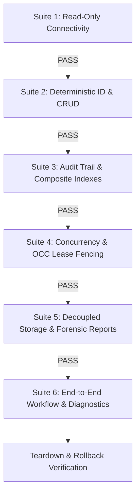
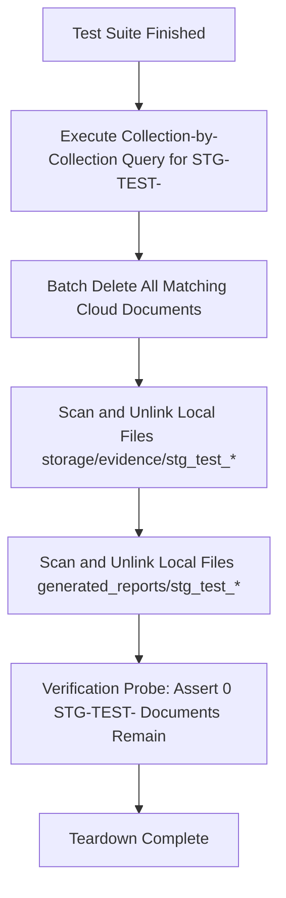

# ChainVault Phase 4E — Firestore Staging Integration Test Plan
**Document ID:** `docs/audit/PHASE_4E_STAGING_INTEGRATION_TEST_PLAN.md`  
**Execution Timestamp:** 2026-10-24T17:42:00+05:30  
**Phase:** Phase 4E — Firestore Staging Integration Test Preparation (PLAN & AUDIT ONLY)  
**Firebase Project:** `chainvault-staging`  
**Database ID:** `(default)` (Cloud Firestore, Standard Edition)  
**Authoritative Source:** MongoDB `chainvault` (6 records, 100% Preserved)  
**Active Backend Engine:** `DATABASE_BACKEND=mongodb` (Unchanged)  
**Current Firestore State:** 0 Top-Level Collections (Pristine)  

---

## 1. Executive Summary & Audit Context

Phase 4E establishes an isolated, non-destructive **Staging Integration Test Plan** to validate ChainVault's Cloud Firestore persistence adapter against the live `chainvault-staging` Cloud Firestore database.

### 1.1 Verified Preconditions
1. **Firebase Security Rules:** Deployed to `chainvault-staging`. Client SDK access is locked (`allow read, write: if false;`), while backend Admin SDK / Application Default Credentials (ADC) operate with server-side IAM permissions.
2. **Composite Indexes:** All 5 required composite indexes (`audit_logs`, `custody_transactions` x2, `reports`, `cases`) are deployed and show status **Enabled** in the Firebase Console.
3. **Application Default Credentials (ADC):** Successfully configured on Windows workstation (`%APPDATA%\gcloud\application_default_credentials.json`) with quota project `chainvault-staging`.
4. **Cloud Connectivity:** Verified live read-only handshake via Python `AsyncClient` to `chainvault-staging` (returned `Firestore connection: SUCCESS`, `Top-level collections: 0`).
5. **Zero Data Contamination:** Cloud Firestore currently contains zero collections.
6. **Authoritative Preservation:** MongoDB database `chainvault` remains untouched with its 6 verified records.

> [!IMPORTANT]
> **Strict Phase 4E Boundary:** This phase is **plan and audit only**. No writes or deletes are executed against Cloud Firestore or MongoDB. No backend configuration switch (`DATABASE_BACKEND`) is performed.

---

## 2. Architectural Subsystem Walkthrough

A comprehensive code inspection was conducted across all core ChainVault subsystems to map database touchpoints:

| Subsystem | Primary Code Files | Database Collections Touched | Key Operations & Semantics |
| :--- | :--- | :--- | :--- |
| **Persistence Adapter** | [`backend/app/database/firestore.py`](file:///D:/parjaayi%20project/CHAINVAULT/backend/app/database/firestore.py) | All 8 collections | `insert_one` (`create`/`set`), `find_one`, `find` (`FirestoreCursor`), `update_one` (`Increment`, merge), `delete_one`, `delete_many`, `count_documents` (`count()` aggregation). |
| **Startup & Lifecycle** | [`backend/app/main.py`](file:///D:/parjaayi%20project/CHAINVAULT/backend/app/main.py)<br>[`backend/app/database/mongodb.py`](file:///D:/parjaayi%20project/CHAINVAULT/backend/app/database/mongodb.py) | Dynamic via `db_client` | `lifespan` startup/shutdown, preflight configuration validation, `DATABASE_BACKEND` factory selection (`MongoDBClient` vs `FirestoreClient`). |
| **Authentication & RBAC** | [`backend/app/security/auth.py`](file:///D:/parjaayi%20project/CHAINVAULT/backend/app/security/auth.py)<br>[`backend/app/security/permissions.py`](file:///D:/parjaayi%20project/CHAINVAULT/backend/app/security/permissions.py) | `users` | JWT bearer token verification, role-based access control (`ADMIN`, `INVESTIGATOR`, `OFFICER`, `AUDITOR`, `TECHNICIAN`, `VIEWER`), bcrypt password hashing. |
| **Evidence Ingestion** | [`backend/app/routes/evidence.py`](file:///D:/parjaayi%20project/CHAINVAULT/backend/app/routes/evidence.py)<br>[`backend/app/services/storage.py`](file:///D:/parjaayi%20project/CHAINVAULT/backend/app/services/storage.py) | `evidence`, `audit_logs` | SHA-256 chunked hashing, storage to disk (`storage/evidence/`), metadata upsert to database, initial `EVIDENCE_INGESTION` audit event logging. |
| **Custody & OCC Locking** | [`backend/app/routes/custody.py`](file:///D:/parjaayi%20project/CHAINVAULT/backend/app/routes/custody.py)<br>[`backend/app/services/custody_transaction.py`](file:///D:/parjaayi%20project/CHAINVAULT/backend/app/services/custody_transaction.py) | `evidence`, `custody_transactions`, `audit_logs`, `idempotency_records` | Distributed lease locking, fencing tokens (`custody_version` CAS), durable intent logging (`PREPARED` -> `ANCHOR_SUBMITTED` -> `CONFIRMED`), idempotency enforcement. |
| **Audit Trail & Merkle Chains** | [`backend/app/services/audit_trail.py`](file:///D:/parjaayi%20project/CHAINVAULT/backend/app/services/audit_trail.py)<br>[`backend/app/routes/audit.py`](file:///D:/parjaayi%20project/CHAINVAULT/backend/app/routes/audit.py) | `audit_logs` | Monotonic `sequence_number` ordering, Merkle parent hashing (`previous_event_hash`), canonical RFC 3339 timestamps, SHA-256 cryptographic invariance. |
| **Blockchain Anchoring** | [`backend/app/services/blockchain.py`](file:///D:/parjaayi%20project/CHAINVAULT/backend/app/services/blockchain.py)<br>[`backend/app/routes/blockchain.py`](file:///D:/parjaayi%20project/CHAINVAULT/backend/app/routes/blockchain.py) | `blockchain_checkpoints` | Smart contract `EvidenceRegistryV2` interaction, checkpoint metadata persistence (`checkpoint_id: CHK-<evidence_id>`). |
| **Forensic Reports** | [`backend/app/services/report.py`](file:///D:/parjaayi%20project/CHAINVAULT/backend/app/services/report.py)<br>[`backend/app/routes/reports.py`](file:///D:/parjaayi%20project/CHAINVAULT/backend/app/routes/reports.py) | `reports` | PDF rendering to disk (`generated_reports/`), QR verification code generation, independent verification by re-hashing PDF bytes from disk. |
| **System Recovery** | [`backend/app/services/recovery.py`](file:///D:/parjaayi%20project/CHAINVAULT/backend/app/services/recovery.py)<br>[`backend/app/routes/recovery.py`](file:///D:/parjaayi%20project/CHAINVAULT/backend/app/routes/recovery.py) | `evidence`, `custody_transactions` | System diagnostics probe, multi-source consistency check (disk + DB + blockchain), orphan cleanup. |

---

## 3. Synthetic Staging Isolation Strategy

To guarantee absolute safety for authoritative MongoDB data, the staging integration tests **will not depend on migrating existing MongoDB records**.

### 3.1 Dedicated Synthetic Fixture Namespace
Every document and physical file generated during staging integration testing will use a deterministic, reserved prefix: `STG-TEST-` (or `stg_test_`).

| Entity | Synthetic Identifier Pattern | Example Staging Identifier | Production/MongoDB Equivalent (Untouched) |
| :--- | :--- | :--- | :--- |
| **Case** | `CASE-STG-TEST-###` | `CASE-STG-TEST-001` | `CV-2026-001` |
| **Evidence** | `EV-STG-TEST-###` | `EV-STG-TEST-001` | `EV-001`, `EV-002` |
| **Audit Log** | `EVT-STG-TEST-###` | `EVT-STG-TEST-001` | `EVT-001`, `EVT-002`, `EVT-003` |
| **Custody Tx** | `TX-STG-TEST-###` | `TX-STG-TEST-001` | `TX-001` |
| **Idempotency** | `IDEM-STG-TEST-###` | `IDEM-STG-TEST-001` | `IDEM-001` |
| **Checkpoint** | `CHK-EV-STG-TEST-###` | `CHK-EV-STG-TEST-001` | `CHK-EV-001` |
| **Report** | `REP-STG-TEST-###` | `REP-STG-TEST-001` | `REP-001` |
| **User** | `user_stg_test_###` | `user_stg_test_01` | `admin`, `officer1` |
| **Disk Evidence** | `stg_test_*.bin` | `storage/evidence/stg_test_ev001.bin` | `storage/evidence/01_contract.pdf` |
| **Disk Report** | `stg_test_*.pdf` | `generated_reports/stg_test_rep001.pdf` | `generated_reports/report_CV-2026-001.pdf` |

### 3.2 Storage Decoupling Preservation
- Evidence binaries will be created exclusively under `storage/evidence/stg_test_*.bin` and unlinked during test teardown.
- Forensic PDF reports will be created exclusively under `generated_reports/stg_test_*.pdf` and unlinked during test teardown.
- **Zero Binary Payload in Database:** In strict accordance with ChainVault architecture, Cloud Firestore documents will contain only string filepaths and SHA-256 hashes.

---

## 4. Test Catalog & Phased Execution Plan

The integration test plan is organized into 6 distinct, sequential suites designed to be run in a dedicated, isolated test runner (e.g. `backend/tests/test_firestore_staging_live.py`) gated by an explicit environment flag: `RUN_CLOUD_STAGING_TESTS=true`.



### Suite 1: Read-Only Cloud Connectivity & Query Validation (Zero Writes)
- **Objective:** Verify live network handshake, authentication via Windows ADC, and index accessibility without creating any documents.
- **Test 1.1:** Instantiate `FirestoreClient` pointing to `chainvault-staging` and call `await client.ping()`. Expected: returns `True`.
- **Test 1.2:** Negative Document Lookup. Query `client.cases.find_one({"case_id": "NON_EXISTENT_CASE"})`. Expected: returns `None` without exception.
- **Test 1.3:** Empty Cursor Traversal. Execute `client.evidence.find({}).to_list(10)`. Expected: returns `[]` without error.
- **Expected Duration:** ~1.5s (includes TLS handshake).

### Suite 2: Deterministic ID Mapping & Document CRUD Suite (Isolated Writes)
- **Objective:** Verify deterministic document keys and CRUD semantics on live Cloud Firestore.
- **Test 2.1 — Deterministic ID Creation:** Insert case `CASE-STG-TEST-001`. Verify Firestore document reference ID is exactly `"CASE-STG-TEST-001"`.
- **Test 2.2 — Duplicate ID Atomic Rejection:** Attempt to insert another document with ID `"CASE-STG-TEST-001"` using `create()`. Verify Cloud Firestore raises `AlreadyExists` and does not overwrite.
- **Test 2.3 — Atomic Update & Increment:** Call `update_one({"case_id": "CASE-STG-TEST-001"}, {"$set": {"status": "ACTIVE"}, "$inc": {"evidence_count": 1}})`. Verify field updated and counter incremented to 1.
- **Test 2.4 — Document Deletion:** Call `delete_one({"case_id": "CASE-STG-TEST-001"})`. Verify document is removed.

### Suite 3: Audit Trail Invariance & Composite Index Execution
- **Objective:** Verify Merkle chain integrity, canonical RFC 3339 timestamp preservation, and that composite queries execute against live Cloud Firestore without `FAILED_PRECONDITION`.
- **Test 3.1 — Canonical Timestamp String:** Insert an audit log with timestamp string `"2026-10-24T12:00:00.000000Z"`. Read back and assert it is a Python `str`, identical bit-for-bit (not converted to protobuf Timestamp object).
- **Test 3.2 — Sequential Merkle Chain:** Insert 3 events for `EV-STG-TEST-001` with `sequence_number` 1, 2, 3, linking each `previous_event_hash` to the predecessor's `event_hash`. Verify `calculate_canonical_event_hash()` matches.
- **Test 3.3 — Composite Index Query Execution:** Execute the composite query:
  ```python
  cursor = client.audit_logs.find({"evidence_id": "EV-STG-TEST-001"}).sort("sequence_number", 1)
  events = await cursor.to_list(10)
  ```
  **Verification:** Query must succeed in Cloud Firestore. If index was missing or building, Cloud Firestore would return `grpc.StatusCode.FAILED_PRECONDITION`. Passing proves index `(evidence_id ASC, sequence_number ASC)` is active!

### Suite 4: Distributed Concurrency, Custody Lease Locking & Fencing
- **Objective:** Validate atomic lease locking, lease expiration, and optimistic concurrency fencing versions across simulated concurrent workers.
- **Test 4.1 — Atomic Lease Acquisition:** Worker A calls `acquire_custody_transfer_lock("EV-STG-TEST-001", actor="officer_a", lease_seconds=10.0)`. Verify returns `(True, lock_token_a, None, version=1)`.
- **Test 4.2 — Concurrent Collision Rejection:** While Worker A holds the unexpired lock, Worker B attempts `acquire_custody_transfer_lock("EV-STG-TEST-001", actor="officer_b", wait_timeout=0.1)`. Verify Worker B returns `(False, None, "LOCKED", version=1)`.
- **Test 4.3 — Safe Lease Renewal:** Worker A calls `renew_custody_transfer_lock("EV-STG-TEST-001", lock_token_a, additional_seconds=20.0)`. Verify returns `True`.
- **Test 4.4 — Fencing Version Release:** Worker A calls `release_custody_transfer_lock("EV-STG-TEST-001", lock_token_a, new_custodian="custodian_b", expected_version=1)`. Verify returns `True`, custodian becomes `"custodian_b"`, and `custody_version` increments to 2.
- **Test 4.5 — Stale Worker Fencing Rejection:** A stale worker attempts to release with old `expected_version=1`. Verify rejected (returns `False`).

### Suite 5: Decoupled Binary Storage & Forensic Reports Suite
- **Objective:** Validate that physical files stay on disk and reports verify independently against Cloud Firestore metadata.
- **Test 5.1 — Evidence File Decoupling:** Save a 1KB synthetic payload to `storage/evidence/stg_test_ev01.bin`. Insert metadata document into Firestore `evidence`. Read document back from Firestore; assert payload bytes are NOT present in document.
- **Test 5.2 — Forensic Report Generation & Integrity Check:** Generate a synthetic report metadata record in `reports` with `report_hash` computed from a disk PDF. Verify `_perform_report_verification()` matches the on-disk hash against Cloud Firestore metadata.
- **Test 5.3 — Composite Index for Reports:** Query `client.reports.find({"case_id": "CASE-STG-TEST-001"}).sort("generated_at", -1)`. Verify executes without index error.

### Suite 6: End-to-End Workflow & Diagnostics
- **Objective:** Validate the full application lifecycle from case creation to report verification and system diagnostics.
- **Test 6.1 — System Diagnostics Integration:** Call `get_system_diagnostics()` with Firestore connected. Verify diagnostics reports `persistence_mode: "persistent"`, `mongo_connected: True` (or Firestore equivalent), and zero errors.
- **Test 6.2 — Full Custody Transfer Lifecycle:** Prepare, lock, anchor (mock/testnet), update status to `CONFIRMED`, release lock, and verify all records in `custody_transactions` and `audit_logs`.

---

## 5. Rollback & Post-Test Cleanup Protocol

To guarantee that staging Cloud Firestore remains pristine after test execution, the test suite must implement an automated, multi-tiered cleanup fixture:



### 5.1 Cloud Document Deletion Routine
```python
async def cleanup_staging_test_fixtures(client: FirestoreClient):
    """Safely purge all synthetic test records without touching real or migrated data."""
    collections = [
        ("cases", "case_id"),
        ("evidence", "evidence_id"),
        ("audit_logs", "event_id"),
        ("custody_transactions", "transaction_id"),
        ("idempotency_records", "idempotency_key"),
        ("blockchain_checkpoints", "checkpoint_id"),
        ("reports", "report_id"),
        ("users", "username")
    ]
    for col_name, pk_field in collections:
        col = client[col_name]
        # Query documents with test prefix
        cursor = col.find({})
        async for doc in cursor:
            doc_id = str(doc.get(pk_field) or "")
            if "STG-TEST" in doc_id or "stg_test" in doc_id:
                await col.delete_one({pk_field: doc_id})
```

### 5.2 Physical Filesystem Teardown
```python
def cleanup_local_test_files():
    """Remove synthetic disk files created during staging run."""
    storage_path = get_storage_path()
    for f in storage_path.glob("*stg_test*"):
        if f.is_file():
            f.unlink()

    reports_path = get_reports_dir()
    for f in reports_path.glob("*stg_test*"):
        if f.is_file():
            f.unlink()
```

### 5.3 Post-Cleanup Verification Gate
After cleanup execution, the test runner executes an assertive probe:
1. `count_documents` on all 8 collections for `STG-TEST` documents must return `0`.
2. Directory scan on `storage/evidence/` and `generated_reports/` for `stg_test` must return `0`.
3. Total top-level collections in Cloud Firestore must be verified.

---

## 6. Concurrency, Idempotency & Staging-Specific Risk Assessment

| Risk Category | Specific Risk Scenario | Likelihood | Impact | Built-In Safeguard / Mitigation |
| :--- | :--- | :---: | :---: | :--- |
| **Transaction Contention** | Multiple workers attempting custody lock on the same evidence simultaneously | Medium | Low | Firestore `@async_transactional` handles concurrency with exponential backoff and up to 5 automatic retries. Rejected worker gracefully receives `LOCKED`. |
| **Composite Index Rejection** | Multi-field query fails with `FAILED_PRECONDITION` | Low | High | All 5 indexes already verified Enabled in Firebase Console. Suite 3 explicitly exercises each composite index to validate. |
| **Document ID Collisions** | Test document overwrites real evidence | Very Low | Critical | Dedicated `STG-TEST-` namespace prevents collisions. Adapter uses `create()` rather than blind `set()` for inserts. |
| **Timestamp Protobuf Drift** | Firestore converts RFC 3339 string to `Timestamp`, breaking SHA-256 Merkle hash | Low | Critical | Adapter enforces `normalize_utc_timestamp()` returning canonical ISO 8601 strings. Test 3.1 explicitly asserts string preservation. |
| **ADC Token Expiry** | Google OAuth token expires during test run | Low | Medium | Google Cloud Python client automatically refreshes tokens via ADC refresh token in `%APPDATA%\gcloud\`. |
| **Accidental Migration Leak** | Running tests triggers MongoDB to Firestore migration | Zero | Critical | Tests do not call `migrate_mongo_to_firestore.py`. Migration script remains emulator-restricted and dry-run by default. |

---

## 7. Human Operator Approval Gates

Before executing any live writes against Cloud Firestore in Phase 4F, the following gates must be confirmed:

- [x] **Gate 1: Firebase Security Rules Active** — Client SDKs blocked (`allow read, write: if false;`).
- [x] **Gate 2: Composite Indexes Active** — All 5 composite indexes verified Enabled.
- [x] **Gate 3: Windows ADC Verified** — Read-only probe succeeded with 0 collections.
- [x] **Gate 4: Authoritative MongoDB Isolated** — 6 records verified intact; no connection between staging tests and MongoDB.
- [ ] **Gate 5: Operator Authorization** — Operator grants approval to run the isolated staging integration test suite against `chainvault-staging`.

---

## 8. Current Test Results Summary

Prior to concluding Phase 4E, the full local regression suite was executed:

```powershell
backend\venv\Scripts\python.exe -m pytest -v backend/tests/test_audit_security.py backend/tests/test_firestore_adapter.py backend/tests/test_migration_script.py
```
**Result:** **38 passed in 6.45s** (100% PASS)

```powershell
# Authoritative MongoDB Record Count Check
python -c "import asyncio; from motor.motor_asyncio import AsyncIOMotorClient; ..."
```
**Result:**
- `idempotency_records`: 0
- `audit_logs`: 3
- `cases`: 0
- `evidence`: 2
- `blockchain_checkpoints`: 1
- `reports`: 0  
**Total:** Exactly 6 records, 100% preserved.

---

## 9. Conclusion & Recommended Next Step

**Phase 4E Status:** **PLANNING COMPLETE — READY FOR PHASE 4F AUTHORIZATION**

The Staging Integration Test Plan provides complete, isolated validation of ChainVault's Cloud Firestore adapter against `chainvault-staging`. By using a synthetic namespace (`STG-TEST-`), it eliminates any dependency on migrating existing MongoDB records and introduces zero risk of data contamination.

### Recommended Next Step (Phase 4F):
Upon operator approval, author and execute the isolated staging integration test runner ([`backend/tests/test_firestore_staging_live.py`](file:///D:/parjaayi%20project/CHAINVAULT/backend/tests/test_firestore_staging_live.py)) to validate live Cloud Firestore operations, followed by automated cleanup.
