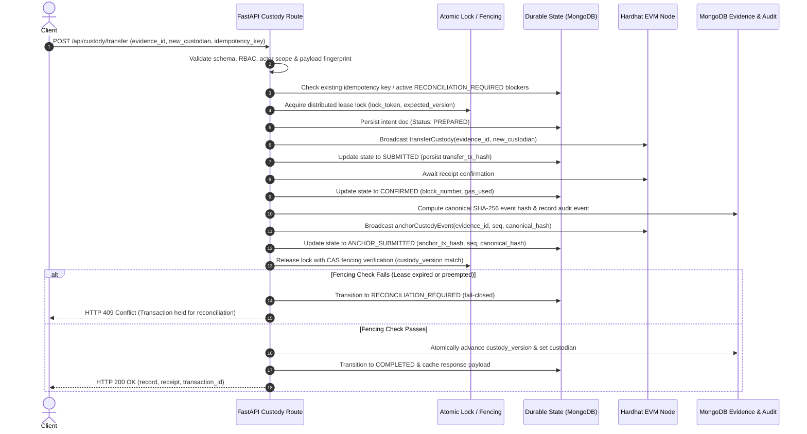

# ChainVault Phase 8B — Blockchain Transaction Consistency Hardening Report

**Authoritative Project Root:** `D:\parjaayi project\CHAINVAULT`  
**Execution Date:** October 21, 2026  
**Status:** Verification Complete — All 223 Tests Passing (32 Concurrency/Consistency Tests Passed)  
**Deployment / Broadcasting Status:** Strictly Dry-Run / Local Isolated Environment (`DEPLOY_BROADCAST=false`, No Render, No Sepolia/Mainnet Broadcasts, No Destructive Cleanups, No Commits/Pushes)

---

## Executive Summary

Phase 8B resolves the fundamental dual-write consistency gap between off-chain database persistence (MongoDB) and asynchronous on-chain smart contract transactions (Ethereum/EVM `EvidenceRegistryV2`). 

Prior to Phase 8B, an unhandled worker crash, lease timeout, or network drop occurring between EVM transaction submission and database commit could cause persistent state divergence—resulting in orphaned on-chain transfers, desynchronized custody histories, or dangerous duplicate transaction broadcasts upon client retry.

Phase 8B introduces a **durable transaction state machine** stored in MongoDB, enforced pre-broadcast intent persistence, lease fencing verification, independent dual-stage on-chain reconciliation (custody transfer vs. cryptographic custody event anchor), and an explicit fail-closed `RECONCILIATION_REQUIRED` blocking state.

---

## 1. Full Custody-Transfer Workflow Trace

The custody transfer lifecycle is orchestrated through 8 deterministic stages:



---

## 2. Durable Transaction State Machine

### 2.1 State Definitions
The state machine is implemented in `backend/app/services/custody_transaction.py` under the enum `CustodyTransactionStatus`:

| State | Semantic Description |
|---|---|
| `PREPARED` | Initial transaction intent persisted to MongoDB before any external RPC broadcast. Captures evidence ID, actor, new custodian, payload fingerprint, lock token, and fencing version. |
| `SUBMITTED` | Smart contract `transferCustody` broadcast submitted. Immediately stores `transfer_tx_hash`. |
| `CONFIRMED` | Transfer transaction confirmed on-chain with receipt (status `0x1`). Stores `block_number`. |
| `ANCHOR_SUBMITTED` | Cryptographic canonical audit log created, and `anchorCustodyEvent` transaction broadcast. Stores `anchor_tx_hash`, `sequence_number`, and `event_hash`. |
| `COMPLETED` | Lock released under fencing verification, custodian and audit logs committed, and response payload cached for idempotency. |
| `FAILED` | Terminal failure prior to on-chain broadcast, or verified on-chain execution revert (receipt status `0x0`). |
| `RECONCILIATION_REQUIRED` | Non-terminal blocker state entered when on-chain execution diverged from local persistence, lease expired before commit, or unexpected anchor hashes were detected. |

### 2.2 Allowed State Transitions
Transitions are strictly guarded by `ALLOWED_TRANSITIONS`. Any illegal transition raises `ValueError`:

```python
ALLOWED_TRANSITIONS = {
    CustodyTransactionStatus.PREPARED: {
        CustodyTransactionStatus.SUBMITTED,
        CustodyTransactionStatus.FAILED
    },
    CustodyTransactionStatus.SUBMITTED: {
        CustodyTransactionStatus.CONFIRMED,
        CustodyTransactionStatus.FAILED,
        CustodyTransactionStatus.RECONCILIATION_REQUIRED
    },
    CustodyTransactionStatus.CONFIRMED: {
        CustodyTransactionStatus.ANCHOR_SUBMITTED,
        CustodyTransactionStatus.RECONCILIATION_REQUIRED
    },
    CustodyTransactionStatus.ANCHOR_SUBMITTED: {
        CustodyTransactionStatus.COMPLETED,
        CustodyTransactionStatus.RECONCILIATION_REQUIRED
    },
    CustodyTransactionStatus.RECONCILIATION_REQUIRED: {
        CustodyTransactionStatus.COMPLETED,
        CustodyTransactionStatus.FAILED
    },
    CustodyTransactionStatus.COMPLETED: set(),
    CustodyTransactionStatus.FAILED: set()
}
```

---

## 3. Pre-Broadcast Intent & Immediate Hash Persistence

### 3.1 Pre-Broadcast Intent
Before calling `transfer_custody_on_chain()` over the network, `create_durable_transaction()` creates a durable document in MongoDB:
```python
durable_tx = await create_durable_transaction(
    evidence_id=ev_id,
    actor_id=actor,
    new_custodian=new_custodian,
    reason=reason,
    idempotency_key=idem_key,
    payload_fingerprint=payload_fp,
    lock_token=lock_token,
    fencing_version=expected_version
)
```
If the worker crashes or network fails before broadcasting, the transaction remains in `PREPARED`. Upon recovery or retry, the system observes that no transaction hash exists, allowing safe restart without double-spending or duplicate transfers.

### 3.2 Immediate Hash Persistence
Immediately upon receiving a transaction hash from Web3/RPC (before waiting for block confirmations), the state machine updates the record to `SUBMITTED`:
```python
await update_transaction_state(
    tx_id,
    CustodyTransactionStatus.SUBMITTED,
    {"transfer_tx_hash": transfer_tx_hash}
)
```
If the HTTP request or process aborts while awaiting the receipt, the transaction hash is already permanently recorded in MongoDB, preventing subsequent retries from submitting a duplicate on-chain transfer.

---

## 4. Safe Retry, Idempotency & Reconciliation Logic

### 4.1 Client Retry Handling
When a request arrives with an existing `idempotency_key`:
1. **Actor Scoping Check:** Rejects requests where `actor_id` does not match the original creator (HTTP 422).
2. **Payload Fingerprint Check:** Compares SHA-256 fingerprint of request payload; rejects modifications (HTTP 422).
3. **Completed Fast-Path:** If already `COMPLETED`, immediately returns the authoritative cached response (HTTP 200).
4. **In-Flight Interruption / Recovery:** If the transaction is in `PREPARED`, `SUBMITTED`, `CONFIRMED`, or `ANCHOR_SUBMITTED`, invokes `reconcile_durable_transaction()`:
   - Queries RPC for `transfer_tx_hash` receipt.
   - If receipt succeeded on-chain, validates the transaction chain ID and contract address.
   - Detects if custody was already transferred on-chain.
   - Verifies if the custody anchor transaction was submitted and matches the canonical event hash bit-for-bit.
   - If reconciled, advances state to `COMPLETED` and returns the successful transfer response.
   - If RPC is unavailable during reconciliation, fails closed with HTTP 503.
   - If unresolvable discrepancy is discovered, fails closed with HTTP 409 and marks `RECONCILIATION_REQUIRED`.

### 4.2 Protection Against Compounding Divergence
Whenever a custody transfer request is initiated for an evidence item, the route checks:
```python
unresolved = await get_unresolved_transactions_for_evidence(ev_id)
if unresolved:
    raise HTTPException(
        status_code=status.HTTP_409_CONFLICT,
        detail=f"Evidence '{ev_id}' has an unresolved transaction requiring reconciliation."
    )
```
This guarantees that an evidence item with an incomplete or ambiguous on-chain state cannot undergo further custody transfers until explicitly investigated and reconciled.

---

## 5. Lease Expiry, Fencing & Clock Assumptions

### 5.1 Fencing Implementation
ChainVault does not rely merely on long lease durations. It implements monotonic fencing:
1. When acquiring a lease, the worker records its `lock_token` (UUID4) and the current `custody_version`.
2. When releasing the lease after completing on-chain operations, the MongoDB update specifies:
   ```json
   {
     "evidence_id": evidence_id,
     "transfer_lock.lock_token": lock_token,
     "custody_version": expected_version
   }
   ```
3. If the worker's lease expired and another worker acquired the lock, `modified_count == 0`.
4. The worker detects this fencing violation, refuses to overwrite the newer database state, transitions its durable transaction record to `RECONCILIATION_REQUIRED`, and aborts with HTTP 409.

### 5.2 Documented Clock Assumptions
- **NTP Time Synchronization:** Node and worker clocks are assumed to be synchronized via NTP within $\pm 1.0$ second drift.
- **Monotonic Version Ordering:** Absolute safety does not depend on clock synchronization because database state updates require atomic CAS on `custody_version` and `lock_token`. Clock expiration is only used as a timeout mechanism to reclaim dead worker locks.
- **Lease Duration Margins:** Default lease TTL is 30.0 seconds. Safe renewals (`renew_custody_transfer_lock`) extend the lease before heavy RPC operations.

---

## 6. Fault-Injection Test Suite & Results

The dedicated suite `backend/tests/test_phase8b_transaction_consistency.py` implements 9 fault-injection scenarios:

| Test ID | Scenario Description | Expected Behavior | Result |
|---|---|---|---|
| **TC-8B-01** | Transaction intent pre-broadcast persistence | Intent saved in `PREPARED` before RPC; completed in `COMPLETED` | **PASS** |
| **TC-8B-02** | Worker crash after transaction submission | Retry detects confirmed on-chain transfer, reconciles without duplicate broadcast | **PASS** |
| **TC-8B-03** | Receipt confirmed but DB update fails | Fencing error transitions transaction to `RECONCILIATION_REQUIRED` | **PASS** |
| **TC-8B-04** | Pending lease expiry / unresolved transaction blocks mutations | Subsequent transfer attempts on evidence return HTTP 409 Conflict | **PASS** |
| **TC-8B-05** | Duplicate request with completed idempotency key | Fast-path returns authoritative cached response without re-executing | **PASS** |
| **TC-8B-06** | Idempotency actor tampering & payload modification | Rejects mismatched actor (HTTP 422) and modified payload (HTTP 422) | **PASS** |
| **TC-8B-07** | In-flight recovery while blockchain RPC is offline | Fails closed with `BLOCKCHAIN_RPC_UNAVAILABLE` (HTTP 503) | **PASS** |
| **TC-8B-08** | Reconciliation detects on-chain anchor hash mismatch | Detects corrupted anchor, transitions to `RECONCILIATION_REQUIRED` | **PASS** |
| **TC-8B-09** | Transaction query and manual reconciliation endpoints | `GET /api/custody/transactions/{id}` and `POST .../reconcile/{id}` function properly | **PASS** |

### Execution Command & Results
```powershell
.\venv\Scripts\pytest tests/test_phase7_custody_concurrency.py tests/test_phase7_audit_validation.py tests/test_phase8b_transaction_consistency.py
```
**Output:** `32 passed, 4 warnings in 44.64s`

### Complete Backend Regression Suite
```powershell
.\venv\Scripts\pytest -q
```
**Output:** `223 passed, 4 warnings in 186.13s (0:03:06)` — Zero failures, zero regressions across entire codebase.

---

## 7. Modified & Created Files Inventory

| File Path | Nature of Change | Purpose |
|---|---|---|
| `backend/app/services/custody_transaction.py` | **NEW** | Durable transaction state machine, lifecycle transitions, on-chain receipt validation, and reconciliation logic. |
| `backend/app/database/mongodb.py` | **MODIFIED** | Added `custody_transactions` property and unique compound indexes on `transaction_id`, `idempotency_key`, and `(evidence_id, status)`. |
| `backend/app/routes/custody.py` | **MODIFIED** | Integrated pre-broadcast intent, state progression, fencing checks, blocker validation, and transaction reconciliation endpoints. |
| `backend/tests/test_phase8b_transaction_consistency.py` | **NEW** | 9 comprehensive fault-injection automated tests validating transaction consistency. |

---

## 8. Operational Recovery Runbook

When a transaction enters `RECONCILIATION_REQUIRED`:

### Step 1: Query Blocked Transactions
```http
GET /api/custody/transactions/{evidence_id}
Authorization: Bearer <ADMIN_OR_INVESTIGATOR_TOKEN>
```
Inspect `transfer_tx_hash`, `anchor_tx_hash`, `status`, and `error_message`.

### Step 2: Inspect On-Chain Status
Verify transaction status on the block explorer or local EVM using `transfer_tx_hash`:
- If `status == 0x1` (Success): Transaction was executed on-chain.
- If `status == 0x0` (Reverted): Smart contract reverted execution.
- If transaction is not found in mempool or blocks: Transaction was never broadcast or dropped.

### Step 3: Trigger Automated Reconciliation
```http
POST /api/custody/transaction/reconcile/{transaction_id}
Authorization: Bearer <ADMIN_OR_INVESTIGATOR_TOKEN>
```
- If the on-chain transfer succeeded and matches metadata, the system recovers the state, persists the custodian change, anchors the audit event if needed, and marks the transaction `COMPLETED`.
- If an unrecoverable discrepancy is detected (e.g. anchor hash mismatch or contract address discrepancy), the endpoint returns HTTP 409 with forensic diagnostic details.

---

## 9. Known Limitations & Remaining Risks

1. **No Distributed Exactly-Once Broadcast Guarantee:**  
   In decentralized EVM networks, no application layer can guarantee *exactly-once* broadcasting without atomic two-phase commit across Ethereum nodes and the local database. ChainVault guarantees **at-least-once delivery with strictly idempotent execution and pre-broadcast intent deduplication**. A broadcast that times out before yielding a transaction hash is held in `RECONCILIATION_REQUIRED` to ensure a retry never produces a duplicate on-chain transfer.
2. **Reorg Edge Cases on Public Testnets:**  
   In the local Hardhat EVM environment, block finality is immediate. When deploying to Sepolia testnet, transactions should await 2-3 block confirmations before marking state as `CONFIRMED` to guard against shallow blockchain reorgs.
3. **Residual Synthetic Records:**  
   In compliance with Phase 7 safety constraints, the four residual `EV-AUDIT71` checkpoint records in `chainvault_test` remain untouched and isolated from production.
